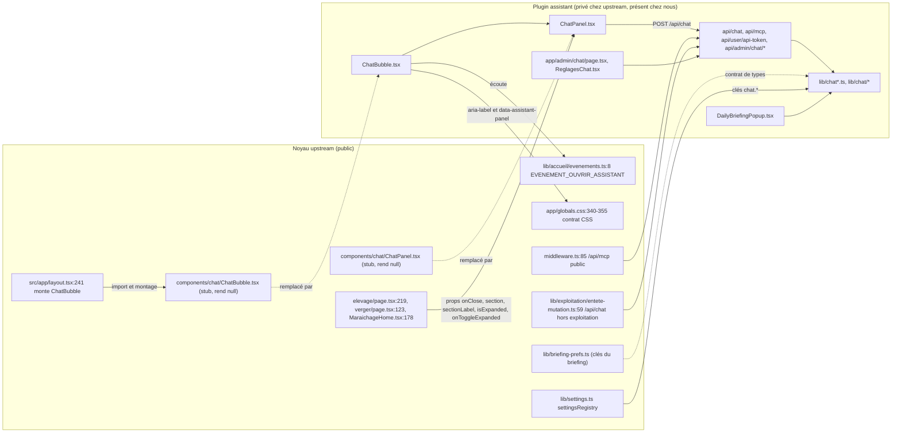
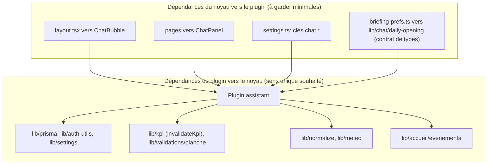
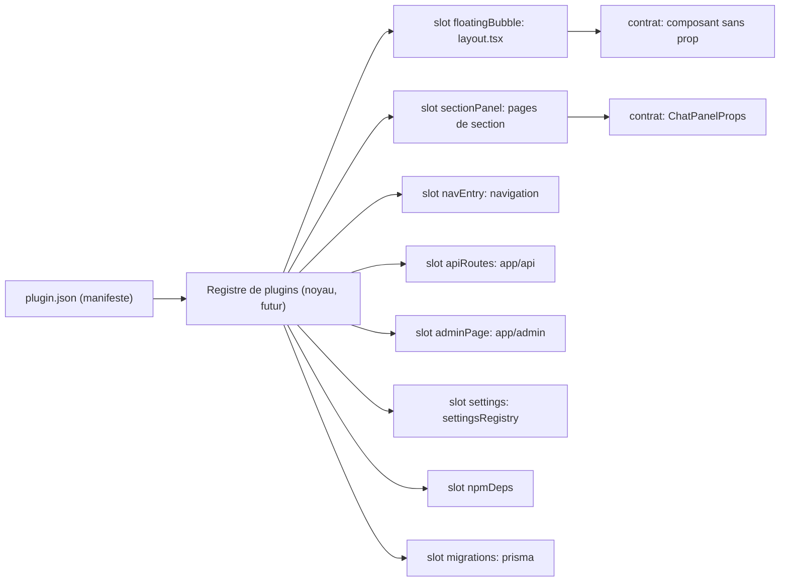

# Contrat noyau upstream et plugin assistant

Version du contrat : 1.0.0 (2026-11-08)
Base d'upstream relevée : `origin/main` au commit `687652df` (identique au merge-base de `feat/chat-ia`)
Vérificateur : `npm run verifier:contratAssistant -- --base origin/main` (`scripts/verifierContratAssistant.ts`)

Ce document décrit ce que le noyau d'upstream promet au plugin assistant, ce que le plugin greffe dans des fichiers d'upstream, et le modèle d'emplacements (slots) qui doit permettre à un second plugin (la boutique) de suivre le même gabarit. Tout est établi depuis le code réel, avec `fichier:ligne` sur l'état `origin/main` sauf mention contraire.

## 1. Vue d'ensemble





Règle directrice : le noyau ne dépend du plugin que par des chemins stables (deux composants, un événement, des sélecteurs CSS, quelques routes). Tout le reste est du code du plugin qui appelle le noyau.

## 2. a) Points d'ancrage côté upstream

### 2.1 Composants stubs

| Composant | Fichier upstream | Signature figée | Montage |
|---|---|---|---|
| `ChatBubble` | `src/components/chat/ChatBubble.tsx:13` | `export function ChatBubble(): null`, aucune prop | `src/app/layout.tsx:15` (import), `:241` (`<ChatBubble />`) |
| `ChatPanel` | `src/components/chat/ChatPanel.tsx:25` | `export function ChatPanel(_props: ChatPanelProps): null` | quatre appelants ci-dessous |

Interface exacte du stub (`ChatPanel.tsx:16-22`) :

```ts
interface ChatPanelProps {
  onClose: () => void          // requise
  section?: string
  sectionLabel?: string
  isExpanded?: boolean
  onToggleExpanded?: () => void
}
```

Relevé des appelants (`git grep -n 'ChatPanel' origin/main -- src`) :

| Appelant | Ligne | Props passées | `section` | `sectionLabel` |
|---|---|---|---|---|
| `src/app/elevage/page.tsx` | 219 | onClose, section, sectionLabel, isExpanded, onToggleExpanded | `"elevage"` | `"Élevage"` |
| `src/app/verger/page.tsx` | 123 | idem | `"verger"` | `"Verger"` |
| `src/components/maraichage/MaraichageHome.tsx` | 178 | idem | `"potager"` | `"Maraîchage"` |

Constats utiles :
- `src/app/page.tsx` et `src/app/comptabilite/**` n'appellent pas `ChatPanel` sur cette base. Le brief mentionnait `app/page`, `arbres/verger` et `comptabilite` : seuls élevage, verger et maraîchage l'utilisent. `MaraichageHome` est monté par `src/app/dashboard/page.tsx:28` (la racine `/` y est réécrite par le middleware pour une session active).
- Les trois appelants passent des props identiques en forme et ne passent jamais `questionInitiale`. Cette prop est un ajout du plugin (`ChatPanel.tsx` du plugin, interface l.14-22) et doit rester facultative.
- Les valeurs de `section` en usage sont `elevage`, `verger`, `potager`. Le plugin y ajoute `briefing` (`DailyBriefingPopup.tsx:45`). Une section inconnue doit être tolérée.
- La bulle ouvre un `ChatPanel` sans `isExpanded` explicite côté noyau : le plugin pilote son propre état.

### 2.2 Événement fenêtre

`src/lib/accueil/evenements.ts:8` : `export const EVENEMENT_OUVRIR_ASSISTANT = "gleba:ouvrir-assistant"`.
Détail : `DetailOuvrirAssistant { question?: string }` (l.10-13). Émetteur : `ouvrirAssistant()` (l.15-18), appelé par la tuile « Demander à Gleba » (`src/components/accueil/TuilesCatalogue.tsx:326`). Le plugin l'écoute dans `ChatBubble` (ajout et retrait de l'écouteur). Le commentaire d'en-tête du fichier (l.1-5) acte le contrat : « l'assistant, monté dans le layout racine, écoute cet événement ».

Le plugin écoute aussi `"ouvrir-chat"` (`ChatBubble.tsx:39`), émis par son propre `DailyBriefingPopup.tsx:44`. Cet événement est interne au plugin et ne fait pas partie du contrat.

### 2.3 Contrat CSS de `globals.css`

Bloc « SHELL v2 », `src/app/globals.css:320-360`. Sélecteurs visés :

| Sélecteur | Ligne | Effet | Ce que le plugin doit exposer |
|---|---|---|---|
| `html.coquille-v2 button.fixed[aria-label="Fermer l'assistant"]` | 340 | remonte le bouton au-dessus de la navigation basse (mobile) | un `<button class="... fixed ...">` avec `aria-label="Fermer l'assistant"` |
| `html.coquille-v2 button.fixed[aria-label="Assistant IA"]` | 349 | masque la bulle sur mobile | un `<button class="... fixed ...">` avec `aria-label="Assistant IA"` |
| `html.coquille-v2 [data-assistant-panel="compact"]` | 352 | positionne et borne le panneau compact | attribut `data-assistant-panel="compact"` sur le panneau non agrandi |

Variables CSS fournies par upstream, que le plugin peut lire : `--app-header-h` (325), `--app-header-visible-h` (326), `--navigation-basse-h` (327, redéfinie à `0px` dès 1024 px). Notre `ChatBubble` les consomme dans la hauteur du panneau (`sm:h-[min(540px,calc(100dvh_-_var(--app-header-visible-h,var(--app-header-h,0px))_-_5rem_-_1rem))]`).

Piège : le sélecteur exige `button.fixed`. Un `aria-label` correct sur un bouton sans la classe `fixed` ne reçoit plus la règle. Le vérificateur contrôle ce point (C06).

### 2.4 Import du public vers le privé

Seul pont de types : `src/lib/briefing-prefs.ts` (l.1-8 en commentaire, exports l.8 et suivants). Le fichier public dit ne pas pouvoir importer `@/lib/chat/daily-opening` sans casser le typage d'un clone, et demande au module privé de réexporter les mêmes symboles.

Contrat de types attendu de `src/lib/chat/daily-opening.ts` :

```ts
export const CLE_PREF_BRIEFING_AUTO: string       // valeur upstream : "briefingQuotidienAuto"
export const BRIEFING_AUTO_PAR_DEFAUT: boolean    // valeur upstream : false
export function briefingAutoActive(prefs: Record<string, unknown> | null | undefined): boolean
```

Consommateurs publics : `src/app/parametres/page.tsx:33` (écrit la clé via `PUT /api/user/preferences`, l.1643), `src/lib/briefing-prefs.test.ts:8` (fige la valeur `"briefingQuotidienAuto"`).

**Écart corrigé (phase 2a)** : `src/lib/chat/daily-opening.ts` réexporte désormais `CLE_PREF_BRIEFING_AUTO` (`"briefingQuotidienAuto"`), `BRIEFING_AUTO_PAR_DEFAUT` et `briefingAutoActive` depuis `@/lib/briefing-prefs` au lieu de les redéfinir, et `DailyBriefingPopup.tsx` importe directement la source d'upstream. Le vérificateur (C09) accepte la délégation par `export { … } from "@/lib/briefing-prefs"` ; si le plugin redéfinit un jour la clé, l'écart redevient un avertissement (échec avec `--strict`).

Autres imports upstream vers les zones privées : `src/lib/verger/creation-arbre.ts:7` et `src/lib/__tests__/coherence-semences-plants-stock-rendements.test.ts:469-471` citent `src/lib/chat/executor-verger.ts` et `tool-executor.ts` en commentaire ou en test conditionnel (« l'absence du fichier n'est pas un échec »). Ce ne sont pas des imports. Le fichier `executor-verger.ts` n'existe pas chez nous.

### 2.5 Routes attendues

| Route | Méthodes | Auth | Où upstream la reconnaît |
|---|---|---|---|
| `/api/chat` | POST | `requireAuthApi(request)` (rate limit IP) | `entete-mutation.ts:59` (hors exploitation) |
| `/api/chat/status` | GET | `requireAuthApi()` | via préfixe `/api/chat` |
| `/api/chat/test` | POST | `requireAdminApi()` | via préfixe `/api/chat` |
| `/api/mcp` | GET, POST | jeton porteur `glb_`, pas de session | `middleware.ts:85` et `:120` (exempté de la session) ; documenté dans `api/public/elevage-openapi/route.ts:77` |
| `/api/user/api-token` | GET, POST, DELETE | `requireAuthApi()`, jeton rattaché à l'acteur (`getActeurId`) | `entete-mutation.ts:50` ; consommé par `parametres/page.tsx:248,261,283` |
| `/api/admin/chat/models`, `codex-models`, `mistral-models` | GET | `requireAdminApi()` | `/api/admin` est une surface d'administration (`impersonation-policy.ts:27`) |
| `/api/admin/chat/codex-login`, `codex-login/poll`, `codex-logout` | POST | `requireAdminApi()` | idem |

Page : `src/app/admin/chat/page.tsx` (lien depuis `src/app/admin/page.tsx`). Le script vérifie la présence et les méthodes exportées (C10) et les deux ancres du middleware (C11).

Point d'attention : `entete-mutation.ts:41-43` affirme que les outils de mutation de l'assistant sont « refusés séparément, à l'exécution (cf. `api/chat/route.ts`) ». Notre `api/chat/route.ts` ne contient pas ce refus (voir `docs/pluginAssistantAuditOutils.md`, section 3). Le contrat côté noyau suppose donc un comportement que le plugin ne fournit pas aujourd'hui.

### 2.6 Réglages `chat.*`

`src/lib/settings.ts` d'upstream définit `SettingDefinition` avec `envKey?: string` (l.13) et `secret?: boolean` (l.17), et exporte `settingsRegistry` (l.40). Le plugin y ajoute sept clés (greffe, voir 3.2) :

| Clé | `envKey` | `secret` | Défaut |
|---|---|---|---|
| `chat.provider` | `CHAT_PROVIDER` | non | `ollama` |
| `chat.model` | `CHAT_MODEL` | non | vide |
| `chat.apiKey` | `CHAT_API_KEY` | oui | vide |
| `chat.baseUrl` | `CHAT_BASE_URL` | non | vide |
| `chat.ollamaHost` | `OLLAMA_HOST` | non | `http://localhost:11434` |
| `chat.codexAccessToken` | aucune | oui | vide |
| `chat.codexRefreshToken` | aucune | oui | vide |

Le type `SettingsRegistry` est un objet fermé : tout plugin qui ajoute des clés modifie ce fichier. C'est la principale source de conflit de merge prévisible (voir 4.3).

### 2.7 Zones `.gitignore` d'upstream

`.gitignore:78-91` d'upstream :

```
/src/components/chat/*
!/src/components/chat/ChatPanel.tsx
!/src/components/chat/ChatBubble.tsx
/src/lib/chat/
/src/lib/ollama.ts
/src/app/api/chat/
/src/app/api/mcp/
/src/hooks/use-chat.ts
/mcp-server/
```

Conséquence : tout fichier du plugin sous ces chemins est ignoré par git chez upstream. Chez nous ils sont suivis (le fork a forcé leur ajout). Un merge d'upstream ne les touche jamais, ce qui est voulu. Inversement, les fichiers du plugin hors de ces zones (`src/lib/chat*.ts`, `src/lib/chat-*.ts`, `src/app/actions/chat-briefing.ts`, `src/app/api/user/api-token/`, `src/app/api/admin/chat/`, `src/app/admin/chat/`, `src/components/admin/ReglagesChat.tsx`) ne sont protégés par aucune règle : si upstream crée un jour un fichier au même chemin, le conflit sera réel. Le script vérifie que les zones restent déclarées (C13).

### 2.8 Dépendances npm

`react-markdown ^10.1.0` et `remark-gfm ^4.0.1` : absentes du `package.json` d'upstream (`git show origin/main:package.json` ne les contient pas), ajoutées par le plugin, utilisées par `ChatPanel.tsx` du plugin (imports l.5-6). Aucune autre dépendance n'est ajoutée. Contrôle C14.

### 2.9 Exclusions `tsconfig.json`

Upstream exclut (`tsconfig.json:41-50`) : `node_modules`, `mcp-server`, `prisma/import-legacy-sqlite.ts`, `scripts/qa/serie-assistant-*.ts`, `scripts/banc-essai-assistant.ts`, `scripts/verif-briefing-20260814.ts`, `src/**/__tests__/**`, `vitest.config.ts`. Le plugin dépend de `mcp-server` et des tests exclus (contrôle C15). Delta du plugin : une ligne `"scripts"` (l.45) qui exclut tout le dossier ; voir 3.2.

### 2.10 Contrat MCP et sécurité du jeton

Sources : `docs/integrations-elevage.md` (section Authentification) et `src/app/api/public/elevage-openapi/route.ts` (entrée `/api/mcp`) sur `origin/main` ; client officiel `gleba-mcp-server` 1.0.1 (npm, AGPL-3.0), lu sans être exécuté (`dist/index.js`).

| Point | Contrat public d'upstream | Client npm (`dist/index.js`) | Notre `/api/mcp` |
|---|---|---|---|
| Jeton | `Authorization: Bearer glb_…`, créé dans Paramètres > API | `GLEBA_TOKEN`, entête Bearer | idem ; sans préfixe `glb_` : 401 sans accès base |
| Liste | `GET /api/mcp`, 200/401/429 | n'appelle jamais GET : ses 39 outils sont codés en dur | `GET` rend `{ tools: [{ name, description, parameters }] }`, outils `get_*` seulement (forme non précisée par le contrat public : choix du plugin) |
| Exécution | `POST { tool, args, section? }`, 200/400/401/429 | envoie `{ tool, args, section }`, lit `data.result` et `error.error` si `!ok` | idem : `{ result }` en 200, `{ error }` sinon |
| Limite | 200 requêtes par 15 min et par jeton | non gérée | idem, clé `mcp:` + SHA-256 du jeton ; jetons invalides comptés par IP |
| Écriture | confirmation dans le client appelant | pas de confirmation, pas de filtre | **403** : lecture seule (voir ci-dessous) |

Écarts à connaître :
- Le client npm déclare 39 outils (`potager`, `verger`, `elevage`, `compta`) avec des paramètres propres. Notre plugin n'en implémente que 8 de lecture (`get_*` de `chat-tools.ts`), les autres répondent **400 « Outil inconnu »**, et ses 7 outils d'écriture du potager répondent 403. Les sections `verger`, `elevage`, `compta` ne sont pas servies : `section` est accepté (chaîne de 100 caractères maximum) mais ne filtre rien.
- Le client npm suppose des arguments (`especeId` en nom, `cultureId` numérique, `plancheId`) qui ne sont pas ceux de nos outils : non aligné, à traiter en phase 2b/2c.
- Le contrat public ne dit pas le format de la liste des outils ni le contenu des erreurs : notés ici plutôt qu'inventés.

**Sécurité : jeton MCP.**
1. Le jeton appartient à la PERSONNE (`getActeurId`), pas au tenant : `/api/user/api-token` est hors du refus par méthode (`entete-mutation.ts:50`), un membre en consultation ne doit donc jamais obtenir un jeton posé sur le compte du propriétaire.
2. L'authentification résout ensuite le contexte avec `resoudreContexteExploitation(acteur)` : les outils reçoivent le tenant, comme dans le chat.
3. Jeton comparé en temps constant (empreintes SHA-256), 401 unique et générique, aucun message d'exception renvoyé, jeton jamais journalisé ni utilisé en clair dans une clé.
4. MCP en lecture seule : un outil dont le nom ne commence pas par `get_` répond 403, y compris pour un propriétaire, tant que les outils d'écriture n'appliquent pas les règles d'upstream (phase 2c).
5. Reste : jeton stocké en clair en base (upstream hache le jeton de capteur en SHA-256, `lib/capteurs/jeton.ts`) ; limite de débit en mémoire donc par processus ; changer cela demande une migration, hors périmètre.

## 3. b) Côté plugin : inventaire des fichiers (hors tests)

Source : `git diff --name-status $(git merge-base HEAD origin/main) HEAD`, 15 commits d'avance.

### 3.1 Fichiers 100 % plugin

| Fichier | Rôle |
|---|---|
| `src/components/chat/ChatBubble.tsx` | remplace le stub : bulle, événements, panneau flottant |
| `src/components/chat/ChatPanel.tsx` | remplace le stub : conversation, markdown |
| `src/components/chat/DailyBriefingPopup.tsx` | popup du briefing quotidien |
| `src/components/admin/ReglagesChat.tsx` | écran de réglages (provider, modèle, clés) |
| `src/app/admin/chat/page.tsx` | page d'administration du chat |
| `src/app/actions/chat-briefing.ts` | server action du briefing |
| `src/app/api/chat/route.ts`, `status/route.ts`, `test/route.ts` | API du chat |
| `src/app/api/mcp/route.ts` | point d'entrée MCP par jeton |
| `src/app/api/user/api-token/route.ts` | gestion du jeton personnel |
| `src/app/api/admin/chat/models`, `codex-models`, `mistral-models`, `codex-login`, `codex-login/poll`, `codex-logout` (6 `route.ts`) | administration des providers |
| `src/lib/chat.ts` | orchestration, prompt système, choix du provider |
| `src/lib/chat-tools.ts` | outils (8 lecture, 10 écriture) |
| `src/lib/chat-contexte.ts` | contexte météo injecté |
| `src/lib/chat-openai-tools.ts`, `chat-anthropic-tools.ts`, `chat-ollama-tools.ts`, `chat-codex.ts` | boucles d'appel d'outils par provider |
| `src/lib/chat/daily-opening.ts`, `daily-briefing.ts` | briefing quotidien |

Attention : `src/app/api/user/api-token/` est classé « plugin » mais sert aussi la page Paramètres d'upstream (`parametres/page.tsx:248-283`). C'est un point d'ancrage inverse : upstream consomme une route du plugin. Le contrat doit le dire (2.5) et le plugin ne peut pas la retirer sans casser Paramètres.

Hors assistant, présent dans le diff : `scripts/seed-associations.ts` (ajout autonome, non lié au plugin) et `package-lock.json` (+1519 lignes, conséquence des deux dépendances et de leurs transitives).

### 3.2 Greffes dans des fichiers d'upstream

| Fichier upstream | Nature précise du delta | Risque de conflit |
|---|---|---|
| `src/app/layout.tsx` | +2 lignes : import de `DailyBriefingPopup` (l.16) et montage `<DailyBriefingPopup />` (l.242) juste avant `<ChatBubble />`. L'import et le montage de `ChatBubble` sont d'origine. | faible, 2 points d'insertion |
| `src/app/admin/page.tsx` | import de l'icône `Bot` ajouté à la ligne d'import lucide-react (l.10) ; un bloc `<Card>` « Réglages du chat IA » inséré (l.183-201) avec lien vers `/admin/chat` | moyen : la ligne d'import lucide est modifiée par tout ajout d'icône |
| `src/lib/settings.ts` | 7 entrées dans le type `SettingsRegistry` (l.21-27) et 7 définitions dans `settingsRegistry` (début de l'objet, l.48+) | élevé : insertion en tête de deux blocs fermés |
| `docker-entrypoint.sh` | le seed arboricole devient opt-in (`SEED_ARBRES=true`), lignes 57-70 : remplace l'exécution inconditionnelle d'upstream. Sans rapport avec l'assistant. | élevé : réécrit un bloc d'upstream |
| `package.json` | + `react-markdown`, `remark-gfm` en dépendances ; + script `verifier:contratAssistant` | faible, mais `package-lock.json` change |
| `tsconfig.json` | + `"scripts"` dans `exclude` (l.45), qui masque tout le dossier au compilateur | faible, mais exclut aussi les futurs scripts d'upstream du typage |
| `prisma/seed-varietes-arbres.sql` | réécriture de 287 lignes (116 ajouts, 171 suppressions) | élevé, et voir ci-dessous |

À trancher sur ce delta (voir section 5) :
- **Le seed arboricole annule des correctifs d'upstream.** Par rapport à `origin/main`, notre version supprime le commentaire de l'Issue #30, remet `intervalle` à `0` au lieu de `4` pour 9 familles (le commentaire d'upstream explique que 0 autoriserait un retour immédiat sur la même planche), n'insère plus la colonne `nom`, et remplace `ON CONFLICT DO NOTHING` par `ON CONFLICT (variete) DO NOTHING`. Le commit d'origine est `513f5b74`. Ce n'est pas une greffe du plugin assistant : c'est une régression de synchro à reprendre depuis `origin/main`.
- `docker-entrypoint.sh` désactive par défaut un seed qu'upstream a rendu systématique (commit upstream `35deb3a2` : « une installation neuve reçoit enfin le catalogue complet »). Le choix opt-in est défendable pour un maraîchage pur, mais il contredit le comportement d'upstream et n'a rien à voir avec l'assistant.
- `"scripts"` dans `tsconfig.json` : à remplacer par une exclusion ciblée du seul `scripts/seed-associations.ts`, qui est la cause probable.

## 4. c) Modèle d'emplacements (slots) et manifeste de plugin

DESIGN uniquement : aucun chargeur n'est implémenté, aucune API n'est publiée.

### 4.1 Principe

Un plugin déclare, dans un manifeste JSON, les emplacements qu'il occupe. Le noyau expose un nombre fini d'emplacements nommés, chacun avec un contrat de props ou de signature. Le noyau ne connaît jamais le code du plugin : il connaît un identifiant d'emplacement et un module résolu par convention de chemin.



### 4.2 Emplacements proposés

| Slot | Contrat (aujourd'hui, dérivé du code) | Cardinalité |
|---|---|---|
| `floatingBubble` | composant React sans prop, monté une fois dans `layout.tsx`, expose les aria-labels et `data-assistant-panel` du contrat CSS, écoute un événement d'ouverture | 1 par plugin, N plugins possibles (position à arbitrer) |
| `sectionPanel` | composant `(props: SectionPanelProps)` avec `onClose`, `section?`, `sectionLabel?`, `isExpanded?`, `onToggleExpanded?` ; le noyau le monte dans chaque page de section et lui passe l'identifiant de section | 0 ou 1 par section |
| `navEntry` | libellé, icône, route, module d'appartenance (ids de `src/lib/modules.ts`) | N |
| `apiRoutes` | liste de `{ chemin, methodes, auth }` avec `auth` dans `session`, `admin`, `jeton` | N |
| `adminPage` | route d'administration et libellé de la carte dans `/admin` | 0 ou 1 |
| `settings` | clés `{ nom, type, defaultValue, envKey?, secret? }`, préfixées par l'identifiant du plugin | N |
| `npmDeps` | dépendances avec plage semver | N |
| `migrations` | dossier de migrations Prisma propre au plugin, numérotées | 0 ou N |
| `events` | événements fenêtre émis et écoutés, avec type de détail | N |

### 4.3 Schéma du manifeste

Clés en camelCase (convention du repo). `contratNoyau` est la version du présent contrat à laquelle le plugin déclare se conformer.

```json
{
  "nom": "string, identifiant stable, camelCase",
  "version": "semver",
  "contratNoyau": "semver du contrat de ce document",
  "licence": "string",
  "slots": {
    "floatingBubble": { "module": "chemin", "labelsAria": ["..."] },
    "sectionPanel": { "module": "chemin", "sections": ["..."] },
    "navEntry": [{ "libelle": "", "route": "", "icone": "", "module": "" }],
    "apiRoutes": [{ "chemin": "", "methodes": [""], "auth": "session|admin|jeton" }],
    "adminPage": { "route": "", "carte": { "titre": "", "description": "" } },
    "settings": [{ "nom": "", "type": "texte|boolean|nombre", "defaultValue": null, "envKey": "", "secret": false }],
    "events": [{ "nom": "", "sens": "emis|ecoute", "detail": "" }]
  },
  "npmDeps": { "paquet": "plage" },
  "migrations": { "dossier": "", "ordre": 0 },
  "permissions": { "ecriture": false, "modulesRequis": [""] },
  "verification": { "script": "chemin du vérificateur de contrat" }
}
```

Le champ `permissions` répond à un manque observé : aujourd'hui rien ne dit qu'un plugin écrit dans les données de l'exploitation, ni quels modules il touche, alors que l'exploitation partagée sait restreindre un membre à certains modules (`src/lib/exploitation/roles.ts:126`).

### 4.4 Exemple : assistant (état réel)

```json
{
  "nom": "assistantIa",
  "version": "0.1.0",
  "contratNoyau": "1.0.0",
  "licence": "a definir",
  "slots": {
    "floatingBubble": {
      "module": "src/components/chat/ChatBubble.tsx",
      "labelsAria": ["Assistant IA", "Fermer l'assistant"]
    },
    "sectionPanel": {
      "module": "src/components/chat/ChatPanel.tsx",
      "sections": ["potager", "verger", "elevage", "briefing"]
    },
    "apiRoutes": [
      { "chemin": "/api/chat", "methodes": ["POST"], "auth": "session" },
      { "chemin": "/api/chat/status", "methodes": ["GET"], "auth": "session" },
      { "chemin": "/api/chat/test", "methodes": ["POST"], "auth": "admin" },
      { "chemin": "/api/mcp", "methodes": ["GET", "POST"], "auth": "jeton" },
      { "chemin": "/api/user/api-token", "methodes": ["GET", "POST", "DELETE"], "auth": "session" },
      { "chemin": "/api/admin/chat/*", "methodes": ["GET", "POST"], "auth": "admin" }
    ],
    "adminPage": {
      "route": "/admin/chat",
      "carte": { "titre": "Réglages du chat IA", "description": "Provider, modèle, clé API" }
    },
    "settings": [
      { "nom": "chat.provider", "type": "texte", "defaultValue": "ollama", "envKey": "CHAT_PROVIDER" },
      { "nom": "chat.model", "type": "texte", "defaultValue": "", "envKey": "CHAT_MODEL" },
      { "nom": "chat.apiKey", "type": "texte", "defaultValue": "", "envKey": "CHAT_API_KEY", "secret": true },
      { "nom": "chat.baseUrl", "type": "texte", "defaultValue": "", "envKey": "CHAT_BASE_URL" },
      { "nom": "chat.ollamaHost", "type": "texte", "defaultValue": "http://localhost:11434", "envKey": "OLLAMA_HOST" },
      { "nom": "chat.codexAccessToken", "type": "texte", "defaultValue": "", "secret": true },
      { "nom": "chat.codexRefreshToken", "type": "texte", "defaultValue": "", "secret": true }
    ],
    "events": [
      { "nom": "gleba:ouvrir-assistant", "sens": "ecoute", "detail": "{ question?: string }" }
    ]
  },
  "npmDeps": { "react-markdown": "^10.1.0", "remark-gfm": "^4.0.1" },
  "migrations": null,
  "permissions": { "ecriture": true, "modulesRequis": ["potager"] },
  "verification": { "script": "scripts/verifierContratAssistant.ts" }
}
```

L'assistant n'a aucune migration : `apiToken` est déjà au schéma d'upstream (`prisma/schema.prisma:92`) et les réglages sont stockés par `settings.ts`.

### 4.5 Exemple esquissé : boutique alternative

La boutique d'upstream existe déjà : pages publiques `/boutique/[slug]` et `/api/boutique/public/*` (`middleware.ts:96-99`), page d'administration `/boutique`. Le plugin alternatif remplacerait l'expérience publique sans toucher à ces chemins. Esquisse, à valider par le mainteneur :

```json
{
  "nom": "boutiqueAlternative",
  "version": "0.0.1",
  "contratNoyau": "1.0.0",
  "slots": {
    "navEntry": [
      { "libelle": "Boutique", "route": "/boutique", "icone": "Storefront", "module": "comptabilite" }
    ],
    "sectionPanel": { "module": "src/components/boutique/PanneauBoutique.tsx", "sections": ["comptabilite"] },
    "apiRoutes": [
      { "chemin": "/api/boutique/public/*", "methodes": ["GET", "POST"], "auth": "session" }
    ],
    "adminPage": { "route": "/boutique", "carte": { "titre": "Boutique", "description": "Catalogue et commandes" } },
    "settings": [
      { "nom": "boutique.devise", "type": "texte", "defaultValue": "EUR" },
      { "nom": "boutique.paiementCle", "type": "texte", "defaultValue": "", "secret": true }
    ]
  },
  "npmDeps": {},
  "migrations": { "dossier": "prisma/migrations/boutiqueAlternative", "ordre": 1 },
  "permissions": { "ecriture": true, "modulesRequis": ["comptabilite"] },
  "verification": { "script": "scripts/verifierContratBoutique.ts" }
}
```

Ce que l'esquisse met en évidence : une boutique a besoin de `migrations` (tables de commandes) et de routes publiques sans session, ce que l'assistant n'exerce pas. Le champ `auth` devra donc distinguer `public` de `session`.

### 4.6 Décisions ouvertes

1. **Résolution des modules.** Convention de chemin figée (`src/components/<plugin>/...`) ou import dynamique piloté par un registre généré au build ? Un registre généré évite de toucher `layout.tsx` à chaque plugin, mais ajoute une étape de build.
2. **Qui écrit les greffes.** Le noyau publie-t-il un point d'extension unique dans `layout.tsx` (`<PluginSlots name="floatingBubble" />`) ? Cela demande un changement upstream, à proposer en PR plutôt qu'à porter en fork.
3. **`settingsRegistry` ouvert.** Le type fermé `SettingsRegistry` oblige à modifier `settings.ts`. Passer à un registre extensible par préfixe réglerait le conflit le plus probable, mais change un fichier central d'upstream.
4. **Emplacement du jeton d'API.** `api/user/api-token` est consommée par Paramètres d'upstream. Soit elle remonte dans le noyau (le correctif du rattachement à l'acteur est fait côté plugin, phase 2a), soit Paramètres la masque quand le plugin est absent.
5. **Plusieurs bulles flottantes.** Assistant et boutique veulent-ils chacun une bulle ? Le contrat CSS actuel suppose une seule paire de libellés.
6. **Migrations de plugin.** Dossier distinct dans `prisma/migrations` (risque d'ordre) ou schéma séparé ? Non tranché.
7. **Version du contrat.** Faut-il un fichier `contrat.json` lisible par le script plutôt que des constantes dans `verifierContratAssistant.ts` ? Utile dès qu'un second plugin existe.
8. **Seed arboricole et entrypoint** (3.2) : reprendre `origin/main` ou assumer le delta ?
9. **Clé du briefing** (2.4) : réexport depuis `briefing-prefs.ts`, à planifier.

## 5. d) Procédure de synchro avec upstream

À exécuter sur une branche de travail (`git switch -c synchro/AAAAMMJJ feat/chat-ia`). Pousser uniquement vers `mine`, jamais vers `origin`.

1. **Récupérer l'état d'upstream.** `git fetch origin`. Aucune écriture dans l'arbre.
2. **Contrôle avant merge.** `npm run verifier:contratAssistant -- --base origin/main`. Ici le script lit l'état d'upstream par `git show origin/main:<chemin>` et notre arbre actuel : il dit si le nouveau noyau change un point d'ancrage (props de `ChatPanel`, sélecteur CSS, valeur de l'événement, exclusions `tsconfig`, zones `.gitignore`, clés du briefing). Un ECHEC à ce stade n'est pas une panne : c'est la liste de ce que le merge va casser.
3. **Lire le diff d'upstream sur la surface du contrat.** `git diff HEAD...origin/main -- src/app/layout.tsx src/app/globals.css src/lib/accueil/evenements.ts src/lib/briefing-prefs.ts src/lib/settings.ts src/middleware.ts src/lib/exploitation tsconfig.json package.json .gitignore`.
4. **Surveiller les routes que nos outils reproduisent** tant que la phase 2 n'est pas traitée : `git log --oneline HEAD..origin/main -- src/app/api/cultures src/app/api/interventions src/app/api/planches src/app/api/varietes src/lib/referentiel-communaute.ts src/lib/cultures`. Chaque commit listé est une règle métier que nos outils ne suivent pas (voir `pluginAssistantAuditOutils.md`).
5. **Merger.** `git merge origin/main`. Conflits attendus, dans cet ordre de probabilité : `src/lib/settings.ts`, `docker-entrypoint.sh`, `src/app/admin/page.tsx`, `prisma/seed-varietes-arbres.sql`, `package.json` et `package-lock.json`, `src/app/layout.tsx`, `tsconfig.json`. Règle : en cas de doute sur un fichier de greffe, prendre la version d'upstream puis réappliquer le delta minimal décrit en 3.2.
6. **Régénérer le verrou.** Si `package-lock.json` est en conflit : prendre celui d'upstream, puis `npm install` pour réajouter `react-markdown` et `remark-gfm`. Ne jamais éditer le verrou à la main.
7. **Contrôle après merge.** `npm run verifier:contratAssistant -- --base origin/main`. Tout ECHEC est à corriger avant de continuer. Aucun AVERTISSEMENT connu n'est attendu depuis la phase 2a ; `--strict` transforme tout avertissement en échec.
8. **Types et lint.** `rm -rf .next/types ; NODE_OPTIONS=--max-old-space-size=6144 npx tsc --noEmit` puis `npm run lint:ci -- --base $(git rev-parse origin/main)` (ligne de base : 5 erreurs, 9 avertissements, pas de régression).
9. **Tests.** `npx vitest run`. Échec connu et préexistant : `growth-campaign` (RFC 8058), à ne pas corriger ici.
10. **Si le contrat change volontairement** (upstream renomme une prop, un sélecteur, une clé) : mettre à jour ce document, les constantes en tête de `scripts/verifierContratAssistant.ts`, et incrémenter la version du contrat (mineure si ajout, majeure si rupture).
11. **Pousser.** `git push mine <branche>`. Vérifier `git remote -v` : `origin` ne doit jamais être la cible.

Ce que le script ne couvre pas : la sémantique des outils (voir l'audit), la conformité visuelle du panneau, et les migrations Prisma.
